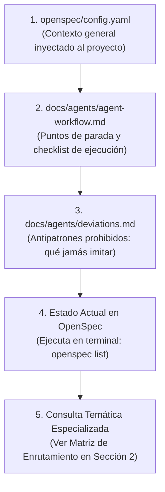

# AGENTS.md — Orquestador de Navegación y Protocolo para Agentes de IA

Este repositorio utiliza el principio **Single Source of Truth (SSOT)**: este archivo no contiene reglas de negocio ni definiciones arquitectónicas. Su único propósito es **enrutar al agente de IA hacia la fuente oficial de cada aspecto del sistema** y definir el protocolo de ejecución.

---

## 1. Protocolo de Arranque Obligatorio (Bootstrap Sequence)

Antes de generar, modificar o analizar código, **todo agente DEBE ejecutar este orden de lectura**:



1. **Contexto general:** [openspec/config.yaml](file:///Users/diegoapariciovela/Desktop/Diego/personal/proyectos/app-presupuesto/openspec/config.yaml)
2. **Metodología y límites:** [docs/agents/agent-workflow.md](file:///Users/diegoapariciovela/Desktop/Diego/personal/proyectos/app-presupuesto/docs/agents/agent-workflow.md)
3. **Catálogo de desvíos prohibidos:** [docs/agents/deviations.md](file:///Users/diegoapariciovela/Desktop/Diego/personal/proyectos/app-presupuesto/docs/agents/deviations.md)
4. **Tarea en curso:** Ejecuta `openspec list` para ubicar el cambio activo en `openspec/changes/<change-id>/`.

---

## 2. Matriz de Enrutamiento Documental (Dónde Buscar Qué)

Cuando necesites diseñar, programar o validar una tarea, dirígete **exclusivamente** al documento especializado que gobierna esa área:

| Si tu tarea involucra... | Lee OBLIGATORIAMENTE este documento |
|---|---|
| **Estructura de módulos KMP, dependencias Konsist (R1-R13) y flujo de capas** | [docs/agents/architecture.md](file:///Users/diegoapariciovela/Desktop/Diego/personal/proyectos/app-presupuesto/docs/agents/architecture.md) |
| **Cálculos monetarios, fórmulas, redondeo Half-Even e invariantes de negocio** | [docs/agents/domain-rules.md](file:///Users/diegoapariciovela/Desktop/Diego/personal/proyectos/app-presupuesto/docs/agents/domain-rules.md) |
| **Pantallas Compose Multiplatform, ViewModels, Contratos MVI y Navegación** | [docs/agents/presentation-mvi.md](file:///Users/diegoapariciovela/Desktop/Diego/personal/proyectos/app-presupuesto/docs/agents/presentation-mvi.md) |
| **Casos de Uso, Domain Services, `TransactionRunner` y Auditoría** | [docs/agents/usecases-services.md](file:///Users/diegoapariciovela/Desktop/Diego/personal/proyectos/app-presupuesto/docs/agents/usecases-services.md) |
| **Esquema SQLDelight, consultas `.sq`, drivers SQLCipher, migraciones y triggers** | [docs/agents/persistence-sqldelight.md](file:///Users/diegoapariciovela/Desktop/Diego/personal/proyectos/app-presupuesto/docs/agents/persistence-sqldelight.md) |
| **Transformación entre capas (Database Row $\leftrightarrow$ Domain $\leftrightarrow$ UiModel $\leftrightarrow$ DTOs)** | [docs/agents/mappers-models.md](file:///Users/diegoapariciovela/Desktop/Diego/personal/proyectos/app-presupuesto/docs/agents/mappers-models.md) |
| **Manejo de errores tipados (`DomainError`), captura de triggers y política de logs** | [docs/agents/errors-logging.md](file:///Users/diegoapariciovela/Desktop/Diego/personal/proyectos/app-presupuesto/docs/agents/errors-logging.md) |
| **Criptografía, backup `.fpbk`, restauración atómica y sync con Google Sheets** | [docs/agents/security-backup.md](file:///Users/diegoapariciovela/Desktop/Diego/personal/proyectos/app-presupuesto/docs/agents/security-backup.md) |
| **Estrategia de pruebas, Fakes, Property-Based Testing y tests de contrato** | [docs/agents/testing.md](file:///Users/diegoapariciovela/Desktop/Diego/personal/proyectos/app-presupuesto/docs/agents/testing.md) |
| **Significado de términos del negocio y trampas conceptuales frecuentes** | [docs/agents/glossary.md](file:///Users/diegoapariciovela/Desktop/Diego/personal/proyectos/app-presupuesto/docs/agents/glossary.md) |
| **Integración inter-contextos (Puertos y Adaptadores ACL)** | [docs/context-map.md](file:///Users/diegoapariciovela/Desktop/Diego/personal/proyectos/app-presupuesto/docs/context-map.md) |
| **Decisiones Arquitectónicas Fundacionales (ADRs)** | [docs/adr/](file:///Users/diegoapariciovela/Desktop/Diego/personal/proyectos/app-presupuesto/docs/adr/) |
| **Especificación de origen completa** | [docs/Prompt Maestro v2.0...md](file:///Users/diegoapariciovela/Desktop/Diego/personal/proyectos/app-presupuesto/docs/Prompt%20Maestro%20v2.0%20-%20Finanzas%20Personales%20KMP%20CMP%20Local-First.md) |

---

## 3. Protocolo Operativo con OpenSpec (Spec-Driven Development)

El ciclo de desarrollo está gobernado estrictamente por **OpenSpec**:

1. **Localizar el cambio activo:**
   ```bash
   openspec list
   ```
2. **Inspeccionar la especificación:**
   - Lee `openspec/changes/<active-change>/specs/` para conocer los requerimientos BDD (`Given/When/Then`).
   - Lee `openspec/changes/<active-change>/tasks.md` para identificar la siguiente tarea pendiente (`- [ ]`).
3. **Desarrollo TDD:**
   - Primero escribe las pruebas basadas en la especificación.
   - Implementa el código mínimo para que compilen y pasen.
   - Ejecuta las verificaciones de arquitectura.
4. **Validación formal:**
   - Marca la tarea completada en `tasks.md`.
   - Ejecuta: `openspec validate <active-change>` antes de reportar el trabajo al supervisor.

---

## 4. Comandos de Verificación Autónoma

Ejecuta estos comandos para validar cualquier cambio antes de dar por terminada una tarea:

```bash
# 1. Configurar entorno JVM en macOS (JBR de Android Studio)
export JAVA_HOME="/Applications/Android Studio.app/Contents/jbr/Contents/Home"

# 2. Compilar targets multiplataforma
./gradlew compileKotlinIosSimulatorArm64 compileDebugSources

# 3. Ejecutar pruebas unitarias y de arquitectura
./gradlew testDebugUnitTest

# 4. Validar integridad de OpenSpec
openspec validate <nombre-del-cambio>
```

---

> **Regla de Oro:** Este documento es un orquestador. Si encuentras contradicciones o ambigüedades entre los documentos especializados y el código, **detén tu ejecución y consulta al supervisor humano**.
